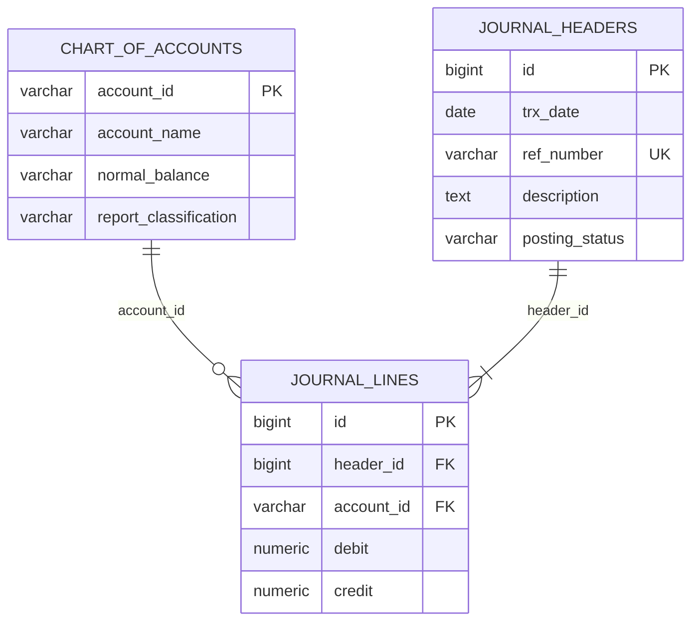

# Jawaban UTS Coding Akuntansi

**Nama:** Fernando Edo Savero  
**Mata kuliah:** Pemrograman / Coding  
**Repository:** [JAWABAN-UTS-PENGKODEAN-FERNANDO](https://github.com/nando-cyber707/JAWABAN-UTS-PENGKODEAN-FERNANDO)

## Struktur

```text
Kode SQL/
  soal-1/
    01-schema.sql
    02-double-entry.sql
    03-test.sql
  soal-2/
    01-trigger.sql
    02-test.sql
  soal-3/
    app.js
    index.html
    schema.sql
    style.css
    supabase-config.js
Prompt/
  01-gemini-canvas.md
  02-notebooklm.md
README.md
```

## Soal 1: General Ledger

Jalankan berurutan pada database PostgreSQL uji:

1. `Kode SQL/soal-1/01-schema.sql`
2. `Kode SQL/soal-1/02-double-entry.sql`
3. `Kode SQL/soal-1/03-test.sql`

Relasi entitas:



Pemisahan header dan baris jurnal menghindari pengulangan tanggal, referensi, deskripsi, dan status pada setiap baris. Atribut deskriptif transaksi bergantung pada `header_id`, sedangkan nama/klasifikasi akun bergantung pada `account_id`; pemisahan ini mengurangi anomali update dan mendukung 3NF. Primary key, foreign key `ON DELETE RESTRICT`, nominal nonnegatif, dan baris satu sisi ditegakkan di database. Header hanya dapat menjadi `POSTED` jika setidaknya dua baris memiliki total debit positif yang sama dengan total kredit. Baris dan header yang sudah diposting tidak dapat diedit atau dihapus.

## Soal 2: Persediaan Perpetual

Jalankan `Kode SQL/soal-2/01-trigger.sql`, kemudian `Kode SQL/soal-2/02-test.sql`. File pertama membuat tabel dari naskah beserta trigger. Skrip uji berjalan dalam transaksi dan diakhiri `ROLLBACK`.

Trigger mengunci baris master dengan `SELECT ... FOR UPDATE` sebelum membaca saldo. Pada isolasi PostgreSQL `READ COMMITTED`, kasir kedua untuk item yang sama menunggu transaksi pertama; setelah lock didapat, ia membaca saldo terkini. Jika saldo sudah habis, `RAISE EXCEPTION` membatalkan insert dan perubahan stok. Contoh dua sesi konkuren terdapat sebagai komentar di `02-test.sql`.

Naskah soal 2 tidak memberikan tabel jurnal, pemetaan akun, kas/utang yang digunakan untuk pembelian, atau harga jual. Oleh karena itu trigger ini menangani mutasi kuantitas dan anti-negative inventory saja. Nominal Persediaan dan HPP perlu diintegrasikan setelah kebijakan akun dan transaksi nominal ditentukan; menebak akun dari data yang tidak tersedia tidak aman untuk pencatatan buku besar.

## Soal 3: Voucher Kas Keluar

Prototype web berada di `Kode SQL/soal-3/`. Jalankan server statis dari folder tersebut (Node.js dan koneksi internet diperlukan untuk perintah `npx`):

```powershell
npx.cmd --yes http-server -p 5173
```

Buka `http://localhost:5173`. Tanpa konfigurasi, aplikasi berfungsi dalam mode demo dan menyimpan data pada `localStorage`; mode ini bukan penyimpanan audit yang aman. Hash di mode demo hanya demonstrasi, bukan kontrol integritas server.

`supabase-config.js` telah diisi dengan URL project dan publishable key yang diberikan. Publishable key memang dirancang untuk dipakai di browser; keamanan data tetap bergantung pada RLS. Jangan pernah menaruh `service_role` key di frontend. Sebelum posting aktif, jalankan `Kode SQL/soal-3/schema.sql` melalui SQL Editor pada project Supabase dan buat pengguna melalui Supabase Auth. Pengguna harus login sebelum RPC `submit_cash_voucher` dapat memposting voucher. RLS membatasi pembacaan ke data milik pengguna dan penulisan langsung ditolak; RPC membuat header/baris dan mempostingnya secara atomik.

UI menghitung debit/kredit dalam sen, menampilkan selisih live, dan menonaktifkan tombol posting sampai header terisi, setidaknya dua baris valid, serta total seimbang. Backend mengulang pemeriksaan saldo. Saat posting, checksum SHA-256 dihitung dari payload header dan baris terurut. Field `created_by`, `created_at`, `posted_at`, `hash_checksum`, serta audit snapshot dicatat di database. Voucher dan baris POSTED dibuat immutable; koreksi dilakukan dengan voucher baru yang mengacu voucher asal dan harus membalik akun/nilai baris secara tepat.

### Catatan PSAK dan AI

Prompt Gemini Canvas dan NotebookLM tersedia di folder `Prompt/`. Prompt NotebookLM meminta verifikasi terhadap sumber resmi PSAK 207 (sebelumnya PSAK 2) terkait definisi kas dan setara kas, pengakuan transaksi, dan klasifikasi arus kas. NotebookLM belum dijalankan dari workspace ini dan sumber resmi belum dilampirkan, sehingga dokumen prompt memisahkan daftar hal yang harus diverifikasi dari hasil yang benar-benar diperoleh. Lengkapi bagian hasil dan sitasi NotebookLM setelah melakukan analisis di akun Anda; jangan menyatakan hasil AI yang belum dijalankan.

## Catatan Validasi

Pemeriksaan statis atas deklarasi tabel, trigger, field audit, dan sintaks JavaScript dilakukan selama penyusunan. PostgreSQL/Supabase belum tersedia di workspace untuk menjalankan seluruh DDL atau pengujian database end-to-end. Mode demo web dapat dicoba melalui server lokal; koneksi cloud memerlukan kredensial project dan akun Supabase Anda.
